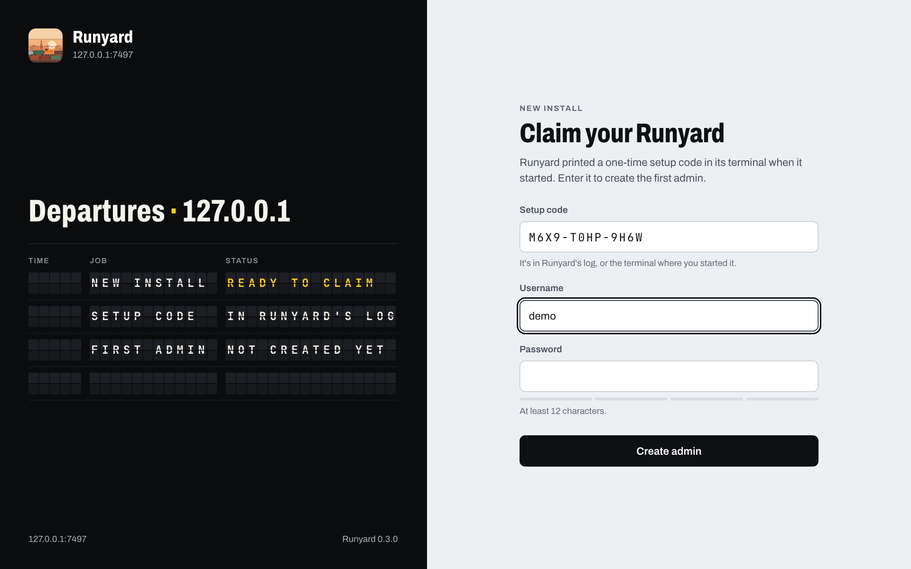
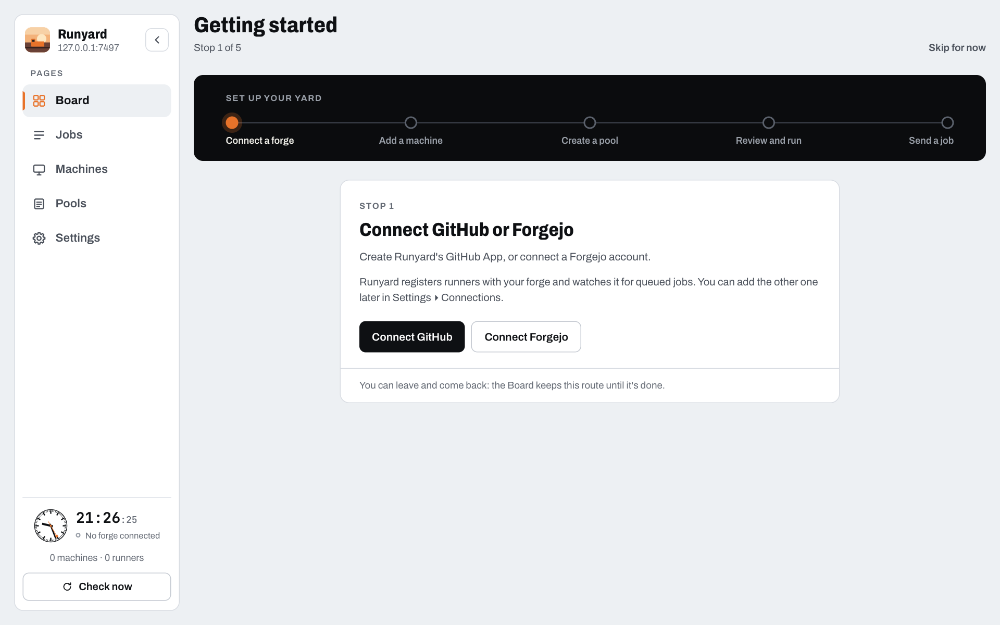
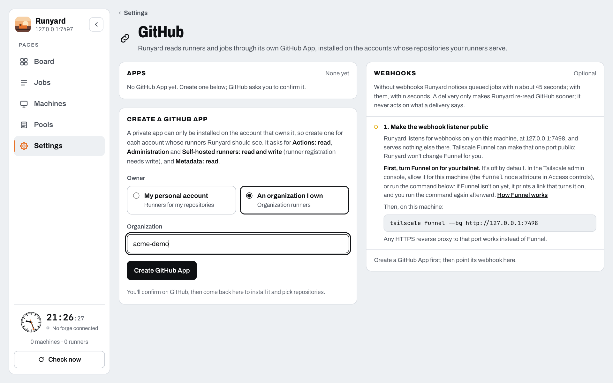
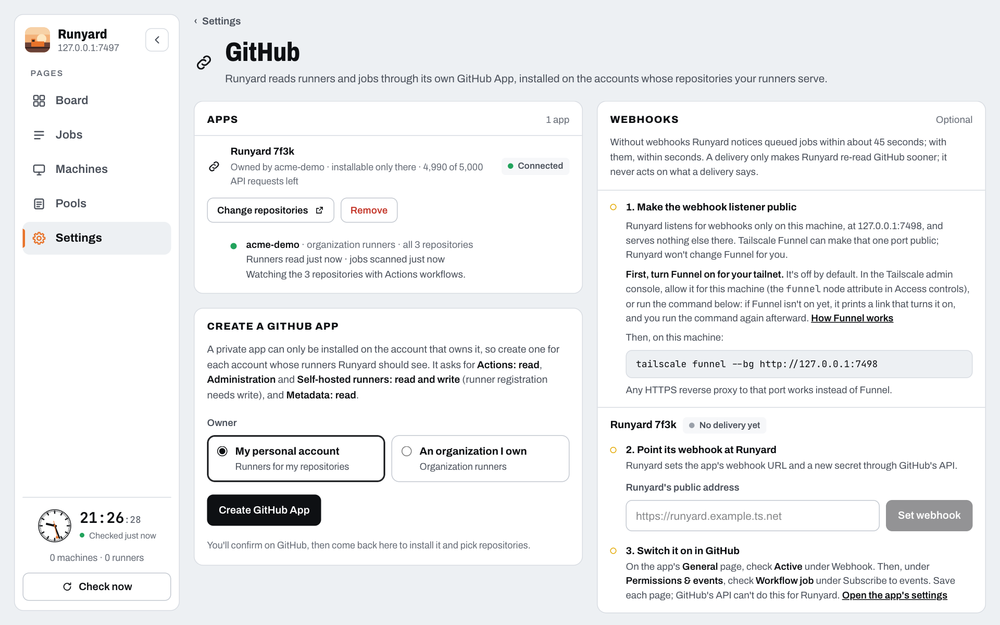
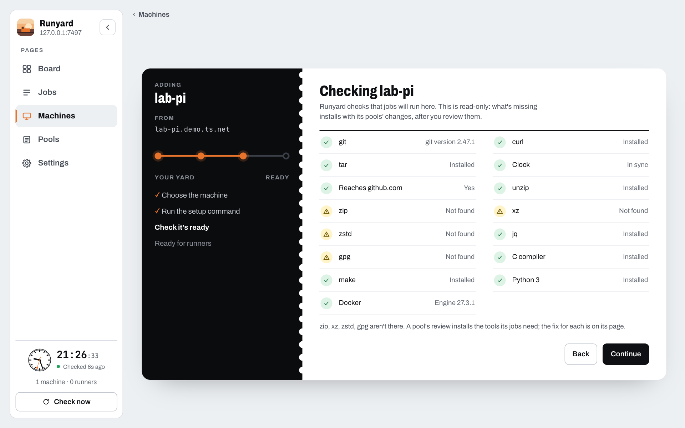
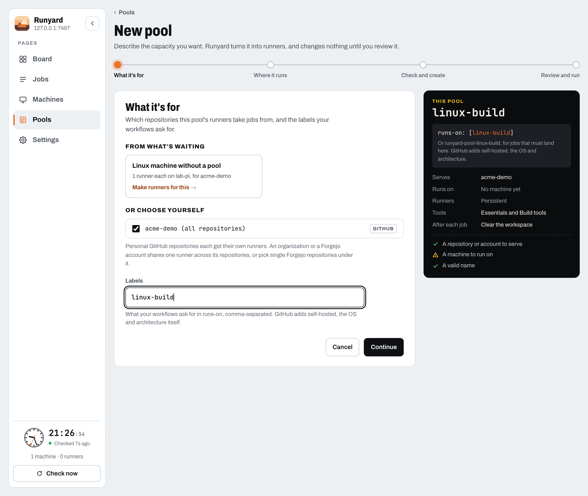
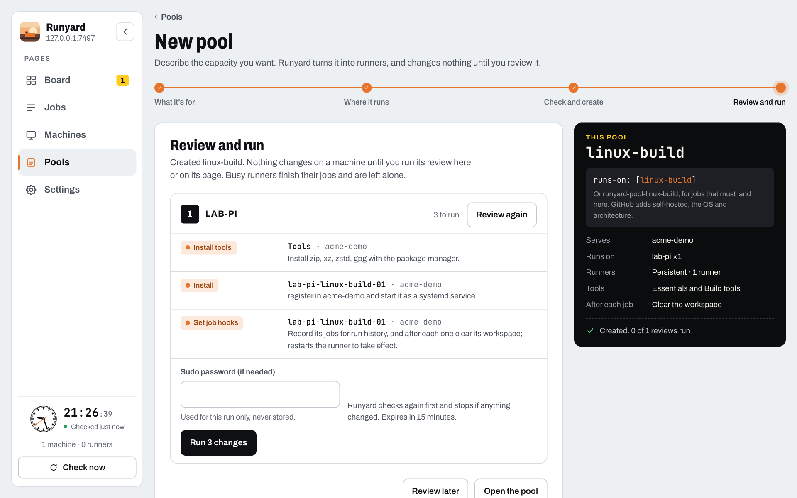
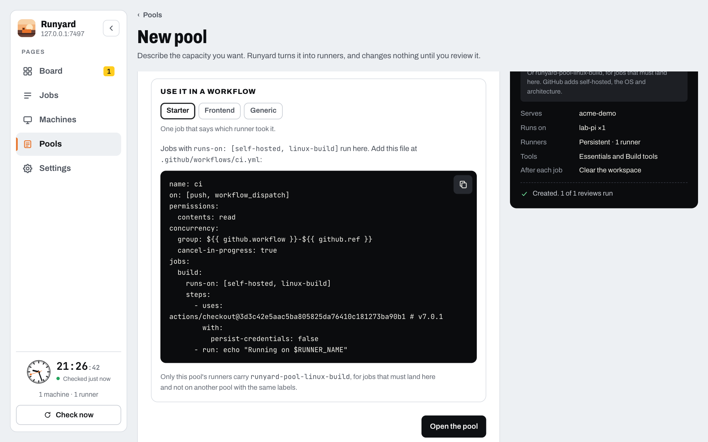

# Getting started

From nothing to a job running on your own machine. Each step links to the page with the
details.

## 1. Install Runyard

Install Runyard once, on the machine that will run its dashboard and control plane: the
Runyard host. Your runner machines don't need it; Runyard reaches them from the host over
SSH, and you add each one from the dashboard with its own one-line setup command (step 4).

**macOS or Linux:**

```sh
curl -fsSL https://frankievalentine.github.io/runyard/install.sh | sh
runyard service install   # keep it running
```

**Windows, in PowerShell:**

```powershell
irm https://frankievalentine.github.io/runyard/install.ps1 | iex
runyard service install   # keep it running
```

The installers download the latest [release](https://github.com/frankievalentine/runyard/releases)
and check its checksum; `RUNYARD_VERSION=0.3.0` pins a version.

To run the Runyard host in Docker instead of installing it, see [Docker](operating.md#docker).
Either way, runner machines are added from the dashboard over SSH.

With [Tailscale](https://tailscale.com) on the Runyard host, with MagicDNS and HTTPS Certificates
turned on for your tailnet, Runyard serves the dashboard at
`https://<machine>.<tailnet>.ts.net:7443`. Without it, it serves `http://127.0.0.1:7420` only, and
you connect machines by hand; see [Without Tailscale](operating.md#without-tailscale).

## 2. Claim it

Runyard prints a one-time setup code when it first starts: in the terminal, or in its log when
it runs as a service (see [Logs](operating.md#logs)). Open the dashboard, enter the code and
create the first admin. Runyard then offers to add a passkey, so you can sign in with Touch ID,
Windows Hello or a security key; **Skip for now** leaves it for **Settings ▸ Account**.
**Getting started** on the Board then walks through the rest.





## 3. Connect your forge

Under **Settings ▸ Connections**:

- **GitHub:** Runyard creates its own GitHub App. You confirm it on GitHub, then install it on
  your account or organization and choose its repositories.
- **Forgejo:** paste an access token with read and write on the user, organization and
  repository scopes.

See [Forges](forges.md).





## 4. Add a machine

On **Machines**, click **Add machine**, then pick a device from your tailnet or enter an SSH
target. The next stop shows one command to run on it; on a fresh Linux container or VPS, run the
fresh-machine version as root. Runyard then checks the machine is ready to build.

The machine needs a few things first, which depend on what it is: see the recipes in
[Machines](machines.md#recipes).



## 5. Create a pool

Click **Put it in a pool** once the machine is ready, or **New pool** on **Pools**. A pool says
which repositories its runners serve, which labels they carry, and which machines they run on.
See [Pools](pools.md).



## 6. Review and run

**Create and review** shows exactly what each machine will get: tools, runners, hooks. Click
**Run** on each. If installing tools needs `sudo` on the machine, enter its password in **Sudo
password**: it's used for that run only and never stored. The runners come online within a
minute.



## 7. Send it a job

The pool's page shows **Use it in a workflow**: the `runs-on` line and a file to copy into your
repository. Start with **Starter** to see a job land on your machine, then pick **Frontend** or
**Generic** for a full CI. Push it, and the job runs on your machine. See
[Writing workflows](workflows.md#start-from-a-template).


